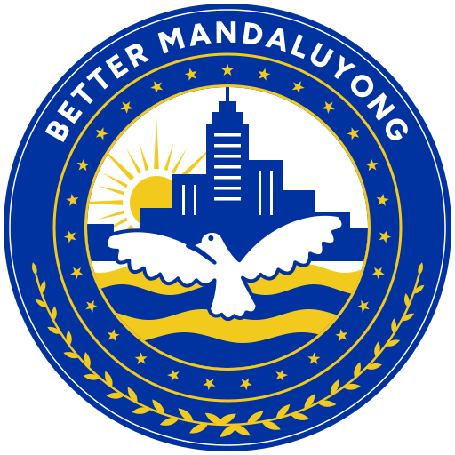

# Better Mandaluyong



The website for **Better Mandaluyong**, a community effort for a more livable
Mandaluyong City: walkable streets, green spaces, and open governance. Right now
it's a launching-soon page; the full site is being built here, in the open, by
volunteers.

Built with **vinext (Next.js App Router on Vite) · React 19 · Tailwind CSS v4 ·
TypeScript**, on Node + pnpm, deployed to Cloudflare Workers. The design follows
the [BetterGov.ph design system](https://bettergov.ph/design), the national
standard the BetterLGU sites share. Run `pnpm dev` and open `/storybook` to see
it.

## Quick start

1. **Install Node ≥ 22.12 (24 recommended) and pnpm**: `brew install node@24`,
   then `corepack enable pnpm`.
2. Install dependencies and one-time git hygiene (commit-message template +
   commit-msg hook):

   ```sh
   pnpm run setup
   ```

3. Start the dev server:

   ```sh
   pnpm dev
   ```

4. Open the URL printed in the terminal (typically <http://localhost:5173>).

New to code, or working through an AI agent? Start with
**[GETTING-STARTED.md](GETTING-STARTED.md)** instead.

## Scripts

| Command               | Description                                                                    |
| --------------------- | ------------------------------------------------------------------------------ |
| `pnpm run setup`      | One-time setup: deps, commit template, commit-msg hook.                        |
| `pnpm dev`            | Start the Vite dev server with hot reload.                                     |
| `pnpm build`          | Production build into `.cloudflare/output/`.                                   |
| `pnpm preview`        | Serve the production build locally in workerd.                                 |
| `pnpm check`          | Run `prettier --check`, `oxlint`, Worker type generation, and `tsc --noEmit`.  |
| `pnpm test`           | Run the unit tests (`vitest run`).                                             |
| `pnpm run deploy`     | Build, then deploy to Cloudflare Workers (see [DEPLOYMENT.md](DEPLOYMENT.md)). |
| `pnpm deploy:preview` | Upload a Worker Preview for the current branch (Production untouched).         |

## Project structure

```
app/            Pages (App Router): layout.tsx root, page.tsx home, storybook/ catalog, globals.css = design tokens
components/     Reusable server components + content.ts (all site copy and links)
public/         Static assets served as-is (logo-seal.svg, logo-mark.svg, png/)
design/         Logo generator (make_logo.py) and PNG exporter
scripts/        setup.ts (pnpm run setup)
.agents/skills/ Repo-level AI agent skills (plan-change, new-component, new-page)
vite.config.ts  Build config: vinext + Tailwind + Cloudflare plugins
cloudflare.config.ts  Cloudflare Workers config
next.config.ts  Redirects
```

## Documentation

- **[GETTING-STARTED.md](GETTING-STARTED.md)**: new to code, or working through
  an AI agent? Start here: machine setup to first pull request.
- **[DEVELOPMENT.md](DEVELOPMENT.md)**: local setup, architecture, and
  conventions.
- **[COMPONENTS.md](COMPONENTS.md)**: the component catalog. Reuse before you
  build.
- **[DESIGN.md](DESIGN.md)**: the BetterGov.ph design system as we use it
  (colors, type, layout, accessibility).
- **[BRAND.md](BRAND.md)**: voice and content rules. How we write.
- **[DEPLOYMENT.md](DEPLOYMENT.md)**: Cloudflare Workers deployment, previews,
  rollback.
- **[AGENTS.md](AGENTS.md)**: guidance for AI coding agents (Claude Code,
  OpenCode, and others read it directly).
- **[NOTICE.md](NOTICE.md)**: credits and license texts for everything we reuse.

## Logo

The logo is a flat redraw of the elements of the Mandaluyong city seal, in the
BetterGov palette shared by the other [BetterLGU](https://lgu.bettergov.ph/)
sites: blue `#0032A0`, gold `#F2C91D` and white.

- **27 stars**, one for each barangay
- **Laurel**, for leadership and honour
- **Rising sun** in the style of the Philippine flag, for a new beginning
- **Skyline** around a central tower, for the city's growth
- **Dove** with wings spread, for freedom and peace
- **Blue and gold waves**, for the Pasig River and the rolling land
  (_madaluyong_) the city is named after

`logo-seal.svg` is the full seal, with "BETTER MANDALUYONG" set in Figtree
ExtraBold (the BetterGov typeface). The site uses it as its logo and favicon.
`logo-mark.svg` is the centre of the seal on its own, for places too small for
the ring of text and stars.

The SVGs are generated, so change `design/make_logo.py` rather than editing them
by hand. Lettering is converted to outlines, so the files need no fonts.

### Regenerate

Requires Python with [fontTools](https://github.com/fonttools/fonttools) and
Node. Fetch Figtree (SIL Open Font License) and rebuild the SVGs:

```bash
curl -L -o /tmp/Figtree.ttf "https://github.com/google/fonts/raw/main/ofl/figtree/Figtree%5Bwght%5D.ttf"
```

```bash
python3 design/make_logo.py /tmp/Figtree.ttf public
```

Then re-export the PNGs. The renderer is installed outside the project so it
doesn't become a site dependency:

```bash
npm install --prefix /tmp/resvg @resvg/resvg-js@2.6.2
```

```bash
NODE_PATH=/tmp/resvg/node_modules node design/export_png.cjs public public/png
```

## Contributing

New to code, or working through an AI agent?
**[GETTING-STARTED.md](GETTING-STARTED.md)** walks the whole loop on this repo:
machine setup, your first agent edit, your first pull request.

1. **Branch, never `main`.** Work on a short-lived branch (any name) and open a
   PR. A merge to `main` deploys, so nothing is ever pushed to `main` directly.
2. **Check before you push.** Run `pnpm check` and `pnpm test`; CI runs both
   plus `pnpm build` on every PR (`.github/workflows/check.yml`).
3. **Conventional commits.** `pnpm run setup` installs the commit template and
   the commit-msg hook that enforce the format.
4. **Docs travel with code.** Token changes update DESIGN.md first; component
   changes update COMPONENTS.md and `/storybook` in the same PR.
5. **Credit what you reuse.** Copying code, text, images, or data from another
   project? Check its license and add it to [NOTICE.md](NOTICE.md) in the same
   PR (rules in [AGENTS.md](AGENTS.md#attribution--credit-what-we-reuse)).

See [DEVELOPMENT.md](DEVELOPMENT.md) for the full workflow, and
[AGENTS.md](AGENTS.md) for AI-coding-agent conventions (including: no AI
attribution trailers in commits or PRs).

## Credits

This site stands on other people's open work:

- **[BetterGov.ph design system](https://bettergov.ph/design)** by the
  BetterGov.ph contributors (MIT): our design tokens, type scale, layout rules,
  and several components are ported from
  [bettergovph/bettergov](https://github.com/bettergovph/bettergov).
- **[Imposter Syndrome Disclaimer](https://github.com/adriennefriend/imposter-syndrome-disclaimer)**
  by Adrienne Lowe (MIT).
- The [BetterLGU](https://lgu.bettergov.ph/) sites, including
  [BetterLB](https://github.com/BetterLosBanos/betterlb),
  [BetterSolano](https://github.com/BetterSolano/bettersolano), and
  [betterlocalgov](https://github.com/iyanski/betterlocalgov), for showing the
  way.

Full details and license texts are in [NOTICE.md](NOTICE.md).

## Impostor Syndrome Disclaimer

**We want your help. No, really.**

There may be a little voice inside your head that is telling you that you're not
ready to be an open source contributor; that your skills aren't nearly good
enough to contribute. What could you possibly offer a project like this one?

We assure you - the little voice in your head is wrong. If you can write code at
all, you can contribute code to open source. Contributing to open source
projects is a fantastic way to advance one's coding skills. Writing perfect code
isn't the measure of a good developer (that would disqualify all of us!); it's
trying to create something, making mistakes, and learning from those mistakes.
That's how we all improve, and we are happy to help others learn.

Being an open source contributor doesn't just mean writing code, either. You can
help out by writing documentation, tests, or even giving feedback about the
project (and yes - that includes giving feedback about the contribution
process). Some of these contributions may be the most valuable to the project as
a whole, because you're coming to the project with fresh eyes, so you can see
the errors and assumptions that seasoned contributors have glossed over.

**Remember:**

- No contribution is too small
- Everyone started somewhere
- Questions are welcome
- Mistakes are learning opportunities
- Your perspective is valuable

(Impostor syndrome disclaimer adapted from
[Adrienne Friend](https://github.com/adriennefriend/imposter-syndrome-disclaimer))

## License

Better Mandaluyong is dual-licensed, like BetterGov.ph. Copyright (c) 2026
Better Mandaluyong contributors.

- **Code** is released under the [MIT License](LICENSE).
- **Content** (the site's text, images, and data) is published under
  [CC BY-NC-ND 4.0](https://creativecommons.org/licenses/by-nc-nd/4.0/); see
  [LICENSE-CONTENT](LICENSE-CONTENT). You may share it unchanged, for
  non-commercial purposes, with credit.

Neither license covers the BetterGov.ph name and logo, which belong to
BetterGov.ph. Work we reuse from other projects keeps its own license; see
[NOTICE.md](NOTICE.md).
